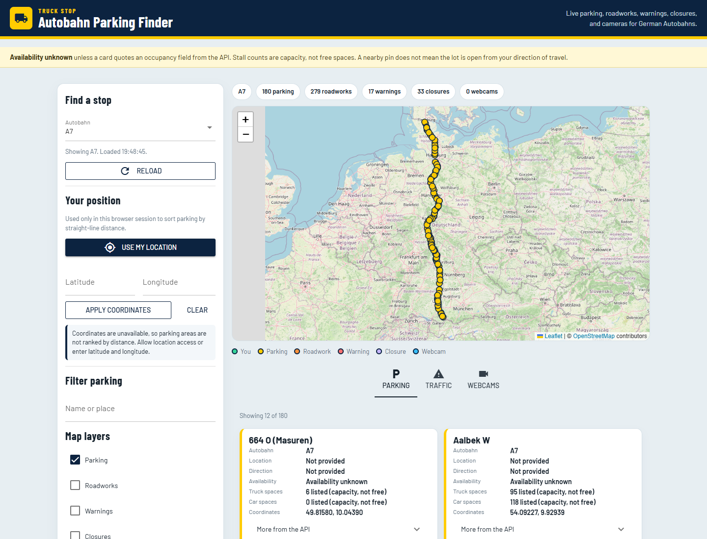
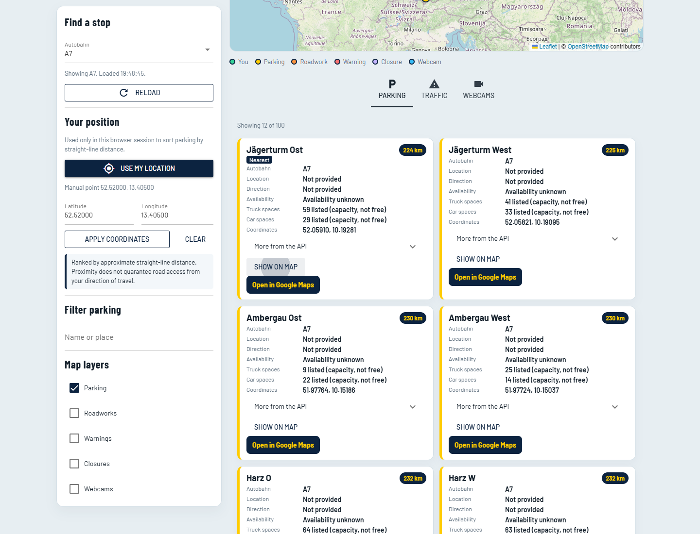
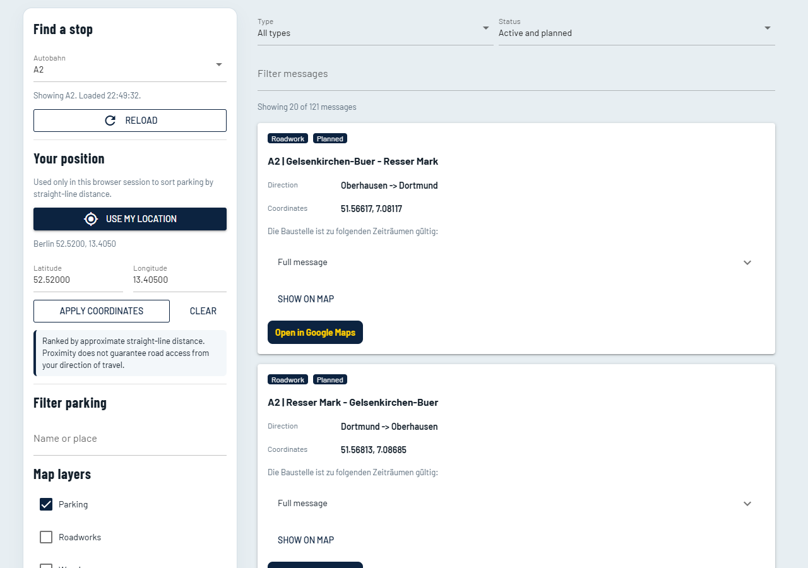
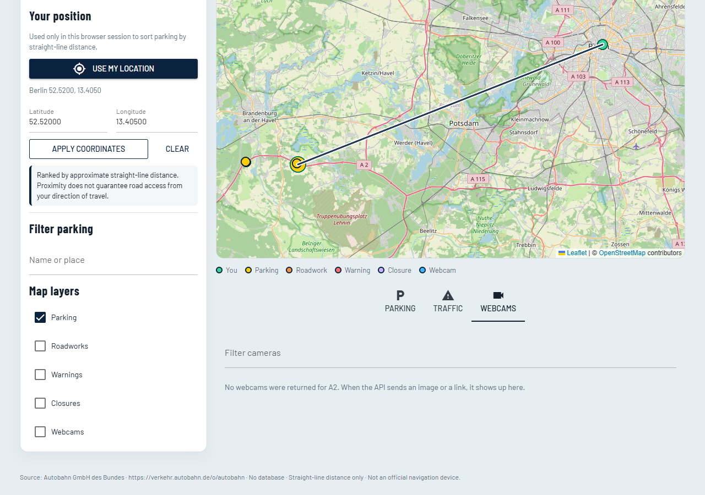
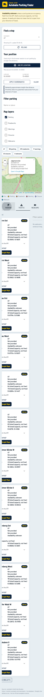

# Smart Autobahn Parking Finder

Source code: https://github.com/Sa605-rgb/autobahn-parking-finder

A local web app for truck drivers who need a truck parking area on a German Autobahn. It loads live data from the public Autobahn API, ranks stops by straight-line distance, and opens the chosen pin in Google Maps.

The app does not promise a free space. If the API does not send occupancy, every card says **Availability unknown**.

## Features

| Feature | Status |
| --- | --- |
| Searchable Autobahn list from the API | Required |
| Truck parking for the selected road | Required |
| Browser location, plus manual latitude / longitude | Required |
| Rank by approximate distance, with a clear message when coordinates are missing | Required |
| Interactive map, marker popup with the stop name | Required |
| Detail cards: name, road, location, direction, other API fields, missing values labeled | Required |
| Open the stop in Google Maps | Required |
| Responsive layout, loading state, errors that do not crash the page | Required |
| Roadworks, warnings, and closures, with type and status filters | Bonus A |
| Webcams, including roads that return none | Bonus B |
| This README | Bonus C |
| Dockerfile and docker-compose.yml | Bonus D |

There is no database. Nothing is stored on disk.

## Architecture

```
main.py                     starts NiceGUI
parking_finder/
  api.py                    httpx client for the Autobahn API
  parse.py                  turns JSON into display models, skips bad records
  geo.py                    coordinates and straight-line distance
  filters.py                search, traffic filters, distance ranking
  formatters.py             labels, Google Maps links, map popup HTML
  dashboard.py              page, location, loading
  panels.py                 cards and map markers
  static/app.css            layout
```

One browser tab is one session. Choosing a road fetches parking, roadworks, warnings, closures, and webcams together. If one call fails, the others still render.

## Prerequisites

- Python 3.12 (3.11 or newer should work)
- Windows, macOS, or Linux
- Internet access to `https://verkehr.autobahn.de`
- No API key

## Run locally

From the project folder.

Windows PowerShell:

```powershell
py -3 -m venv .venv
.\.venv\Scripts\Activate.ps1
python -m pip install -r requirements.txt
python main.py
```

macOS or Linux:

```bash
python3 -m venv .venv
source .venv/bin/activate
python -m pip install -r requirements.txt
python main.py
```

Open **http://127.0.0.1:8080**.

The process listens on `0.0.0.0` and port `8080`, so another device on the same network can use your computer's LAN address. Set `HOST=127.0.0.1` if you want it only on this machine.

Stop the app with Ctrl+C.

### Send a link to a friend

`http://127.0.0.1:8080` only works on your computer. To share it, start once with:

```powershell
$env:ON_AIR='1'
$env:OPEN_BROWSER='0'
python main.py
```

The terminal prints a line like `NiceGUI is on air at https://....on-air.io/...`. Send that address. It stays up only while this app is running and your computer is awake and online.

### Optional developer install

```powershell
python -m pip install -r requirements-dev.txt
python -m pytest
```

## Configuration

Copy `.env.example` to `.env` only if you need to change a default. The app runs with no `.env` file. No secrets are used.

| Variable | Default | Meaning |
| --- | --- | --- |
| `HOST` | `0.0.0.0` | Bind address |
| `PORT` | `8080` | Port |
| `OPEN_BROWSER` | `1` | Open a browser when you start the app. Docker sets this to `0` |
| `AUTOBAHN_TIMEOUT` | `20` | Seconds to wait for the API |
| `AUTOBAHN_SSL_VERIFY` | `1` | Set to `0` only if a company proxy breaks certificate checks |
| `AUTOBAHN_BASE_URL` | `https://verkehr.autobahn.de/o/autobahn` | API root |
| `ON_AIR` | `0` | Set to `1` to print a temporary public link while this computer stays on |

On Windows, the app uses the operating-system certificate store (`truststore`) so a company root certificate that Windows already trusts still verifies the API.

## API

Documentation: https://autobahn.api.bund.dev/

Base URL: https://verkehr.autobahn.de/o/autobahn

| What the app loads | Endpoint |
| --- | --- |
| Road list | `GET /` |
| Truck parking | `GET /{roadId}/services/parking_lorry` |
| Roadworks | `GET /{roadId}/services/roadworks` |
| Warnings | `GET /{roadId}/services/warning` |
| Closures | `GET /{roadId}/services/closure` |
| Webcams | `GET /{roadId}/services/webcam` |

The list payloads already include coordinates, titles, and descriptions, so the app does not call the per-item detail routes.

The live feed has moved past the older OpenAPI examples. Parking coordinates usually arrive as GeoJSON (`coordinates` is longitude, then latitude). Some records still use `{lat, long}` or a `point` string. Titles are often `A7 | undefined`, and the place name is in `subtitle`. The parser accepts those shapes and skips a record it cannot read.

## Location, distance, and availability

- The first screen asks for a road, then a location. **A1** to **A7** are one tap. Any other road is in the list. **Use my location**, a city button, or typed coordinates all do the same job.
- **Use my location** asks the browser. That works on `http://127.0.0.1` and `http://localhost`. If you deny it, or the browser has no location API, tap a city or type coordinates. A denial does not wipe coordinates you already entered.
- **Use these coordinates** and **Apply coordinates** use the latitude and longitude fields. Latitude must be between -90 and 90. Longitude must be between -180 and 180.
- With no coordinates, stops are alphabetical and the page says ranking is off.
- With coordinates, stops are sorted by straight-line kilometres. Stops with no coordinates stay at the bottom.
- Distance is not a driving route. A nearby pin does not mean you can reach that lot from your direction of travel.
- `LKW Stellplätze` and `PKW Stellplätze` are listed capacity, not free spaces. Cards say **Availability unknown** unless the payload has a real occupancy field.

## Screenshots

Desktop, Autobahn A7, parking markers on the map:



Marker popup after **Show on map**, with distance from a manual point in Berlin:



Traffic tab (roadworks, warnings, closures):



A road with no cameras:



Phone-width layout:



## Verify it is working

1. Start the app and open http://127.0.0.1:8080.
2. The first screen should list **A1** through **A7**. The road list underneath loads about 100 roads.
3. Tap any road, for example **A1** or **A7**. The line under the buttons should name that road.
4. Tap **Berlin**, or **Use my location**. The screen closes. The bar says `Nearest on A1` (or whichever road you picked), the map shows your point and that stop, and the first card is marked **Nearest**.
5. Every parking card should say **Availability unknown**.
6. **Open nearest in Google Maps** opens directions from your point. **Show on map** opens the popup.
7. Open **Traffic** and **Webcams**. Webcams may be an empty state. That is a real API result, not a crash.
8. `python -m pytest` should pass without calling the network.

## Live link

IONOS webspace only serves HTML and PHP, so this Python app cannot run there. [Render](https://render.com) runs the Docker image and gives an `https://` address. The reviewer opens that address. No zip.

1. Push this folder to GitHub.
2. Sign in at https://dashboard.render.com with GitHub.
3. **New** → **Blueprint** → select the `autobahn-parking-finder` repo.
4. Apply. The first start takes a few minutes. Render prints a URL like `https://autobahn-parking-finder.onrender.com`.

The free service sleeps after inactivity. The first open can take about a minute, then the app loads. **Use my location** works on that `https://` address.

## Docker

The container listens on `0.0.0.0:8080` and does not try to open a browser.

```bash
docker compose up --build
```

Or without Compose:

```bash
docker build -t autobahn-parking .
docker run --rm -p 8080:8080 autobahn-parking
```

Then open http://127.0.0.1:8080.

Mapped port: host `8080` to container `8080`. Override the host port with `8081:8080` if 8080 is taken. No environment variables are required. `HOST`, `PORT`, and `OPEN_BROWSER` are set in the image.

## Known limitations

- The API does not provide live free-space counts for truck parking. Do not treat a marker as an open bay.
- Straight-line distance ignores the carriageway, exits, and which direction you are driving.
- On 9 October 2026 the webcam list was empty for every road the API publishes. The webcam tab still renders an image and a link when `imageurl` or `linkurl` is present, and it says so when they are not.
- Camera images are loaded from third-party hosts. A host can block the preview. The link on the card is the fallback.
- Traffic lists are long. The page shows 20 messages at a time, then **Show more**. Parking cards show 12 at a time. The map still plots every parking coordinate for the current filter.
- Roadwork and warning geometry can be a line. The marker uses a point or the middle of the extent, so it is a hint, not the whole work zone.
- The service is a public read-only feed. It can time out or return an empty list for a road. The page shows that message and keeps running.

## Troubleshooting

| What you see | What to do |
| --- | --- |
| `The Autobahn API timed out` | Check the network and press **Reload**. Raise `AUTOBAHN_TIMEOUT` if the link is slow. |
| `certificate could not be verified` | Leave `truststore` installed. If a proxy still intercepts TLS, set `AUTOBAHN_SSL_VERIFY=0` in `.env` and restart. Only do that on a network you trust. |
| Road list stays empty | The API returned no roads, or every call failed. The red banner has the reason. |
| Location button does nothing useful | The browser denied location. Type latitude and longitude. Use `http://127.0.0.1:8080`, not a raw LAN IP, if you want the browser prompt. |
| Map is grey | The tile server (`tile.openstreetmap.org`) is blocked, or the page was opened before the map finished loading. Refresh. |
| Port already in use | Stop the other process or set `PORT=8081`. |
| Docker build cannot reach the API | The container needs outbound HTTPS. A corporate TLS intercept may require `AUTOBAHN_SSL_VERIFY=0` in the Compose `environment` block. |
